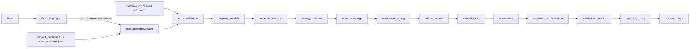

# ENERGY-008 Software Architecture

**Document ID:** ENERGY008-SW-ARCH-001  
**Revision:** 0.1-DRAFT  
**Phase:** Prompt 18, MATLAB architecture and reproducible startup  
**Model:** ENERGY008-MODEL-0.1.0  
**PFD:** ENERGY008-PFD-001 Rev 0.1-DRAFT  
**Reaction network:** ENERGY008-RXN-0.1.0  
**Property data:** ENERGY008-DATA-0.1.0  
**Schema:** ENERGY008-SCHEMA-0.1.0

## 1. Architectural intent and design boundary

The project is a modular, data-driven MATLAB process-model framework. Its calculation engine is independent of the user interface. GUI code may collect and display data, but it cannot contain process equations, property correlations, solver loops, equipment sizing, or KPI calculations.

Prompt 18 implements the project tree, root discovery, explicit path policy, configuration/manifest validation, source-data resolution, file-integrity checks, run-folder management and logs. Calculation modules are API contracts only. No solver is represented as complete. The Prompt 19 implementation must be based on the approved model methods and Prompt 17 independent fixtures.

The flowsheet remains a hybrid nonlinear system with sequential model blocks, inner property/flash and separation calculations, and an outer recycle closure. The numerical methods in `data/raw/ENERGY008_Numerical_Methods.md` govern iteration and acceptance. A solver success flag alone is not acceptance. Every result must pass physical and independent QA gates.

### 1.1 Frozen identifiers and inherited status

| Item | Version / status |
|---|---|
| Selected working route | Route C: biogenic CO2 + renewable electrolytic H2, pressurised ALK reference |
| Route gate | Approval not evidenced in prior-phase record |
| Design basis | ENERGY008-DB Rev 0.1-DRAFT; G3 not frozen |
| PFD | ENERGY008-PFD-001 Rev 0.1-DRAFT |
| Process streams | 55 conceptual stream IDs; physical states/flows not solved |
| Equipment register | 28 equipment tags; ratings not established |
| Reaction network | ENERGY008-RXN-0.1.0; independent R-01, R-02 and E-01 |
| Property data | ENERGY008-DATA-0.1.0; curated subset, not a complete process property package |
| Stream/reaction schema | ENERGY008-SCHEMA-0.1.0 |
| Algorithm/QA | ENERGY008-NM-001 Rev 0.1-DRAFT |
| Hand-check fixture | ENERGY008-HAND-BASE-C-01, 50,000 kg/day MeOH component-equivalent |

R-01 is CO2 + 3 H2 ⇌ CH3OH + H2O; R-02 is CO2 + H2 ⇌ CO + H2O; E-01 is 2 H2O → 2 H2 + O2. CO hydrogenation is not an independent reaction vector in the selected stoichiometric basis. The Prompt 17 zero R-02 extent is only a reference-block assumption, not a real-reactor conclusion.

## 2. Project tree

```text
ENERGY008_MATLAB/
├── .energy008-root
├── MATLAB/
│   ├── START_HERE.m
│   ├── main.m
│   ├── input_validation.m
│   ├── property_models.m
│   ├── material_balance.m
│   ├── energy_balance.m
│   ├── entropy_exergy.m
│   ├── equipment_sizing.m
│   ├── utilities_model.m
│   ├── control_logic.m
│   ├── economics.m
│   ├── sensitivity_optimisation.m
│   ├── validation_checks.m
│   ├── reporting_plots.m
│   ├── project_config.json
│   ├── private/
│   │   ├── resolve_project_data.m
│   │   └── sha256_file.m
│   ├── gui/
│   ├── tests/
│   └── docs/
├── data/
│   ├── data_manifest.json
│   ├── raw/
│   ├── processed/
│   ├── reference/
│   └── schemas/
├── tests/
├── outputs/
├── logs/
├── flowcharts/
└── documentation/
```

The `MATLAB/` folder is the only runtime source path in Prompt 18. `private/` functions are private to the MATLAB parent directory. GUI, tests, documentation, data, outputs, logs and flowcharts are not added to the MATLAB path.

## 3. Startup and execution sequence

1. `START_HERE.m` reads its own location with `mfilename('fullpath')`.
2. It walks upward from that location until both `.energy008-root` and `MATLAB/project_config.json` exist.
3. It verifies the project marker and project ID in the JSON configuration.
4. It adds only explicitly declared runtime source folders. The baseline allows only `<projectRoot>/MATLAB`. `genpath` is prohibited.
5. It calls `main(projectRoot, configPath)`.
6. `main` creates/checks project-contained `outputs/`, `outputs/reports/` and `logs/` roots, then reserves a unique run folder and log names. This occurs before config/data validation so startup failures can be recorded. Existing runs are never reused.
7. `main` validates configuration and manifest structure, confirms configured data roots are inside the project, and verifies config/manifest integrity.
8. Data resolution checks explicit manifest paths first, exact filenames second, and only a documented per-dataset regex rule third. Multiple matches stop execution with candidate paths.
9. The resolver checks the declared extension, configured root containment and SHA-256. No unsupported format or changed source is silently accepted.
10. `main` writes run JSON/text logs with the final success or failure status. A successful startup is `STARTUP_READY`, while `calculation_status` remains `NOT_RUN`. Process calculations are not launched in Prompt 18.

No root/data logic uses `pwd`. `pwd` is used only in the MATLAB smoke test to deliberately switch to an unrelated directory and test independence.

## 4. Engine / GUI separation



This is a target architecture, not an executed call chain. The implementation sequence may call property models at multiple points. The outer PFD/model dependency graph and Prompt 16 sequence remain authoritative; a single linear pass must not replace inner iterations or recycle closure.

### 4.1 GUI contract

The GUI is an optional client. It passes a validated request structure to the public orchestrator, subscribes to status/diagnostic outputs and renders accepted results. It cannot call private functions, mutate project data files, resolve ambiguous sources itself, or bypass input validation. Prompt 18 does not include a GUI application and does not add `MATLAB/gui` to the default path.

## 5. Canonical model data structures

All entities carry explicit identifiers, versions, units, source lineage and status. The same canonical field names are used by data import, calculation modules, tests and GUI.

### 5.1 `modelInput` bundle

| Field | Type / content | Rules |
|---|---|---|
| `schema_version` | char/string | Must equal `ENERGY008-SCHEMA-0.1.0` or an explicitly migrated compatible schema |
| `versions` | struct | `project`, `design_basis`, `pfd`, `model`, `reaction_network`, `property_data`, `schema`, `fixture` |
| `components` | struct array | Component records and element vectors |
| `reactions` | struct array | Stoichiometric coefficients, basis, rank/dependency metadata |
| `streams` | struct array | Stream state, component flows, composition basis and completeness status |
| `equipment` | struct array | Equipment tags, type, service, operating/design state and rating provenance |
| `utility_systems` | struct array | Utility interfaces, supply/return conditions, tariffs and source metadata |
| `scenarios` | struct array | Base/alternative/upset scenario definitions and assumptions |
| `property_data` | struct/catalog | Source records, correlations, validity ranges and EOS/VLE metadata |
| `kpis` | struct array | KPI equations, units, boundary and result status |
| `diagnostics` | struct array | Machine-readable diagnostics accumulated during the run |
| `provenance` | struct array | Source document, page/sheet/table/row, source ID, hash and transformation history |

### 5.2 Entity contracts

**Component:** `component_id`, `name`, `formula`, `molecular_weight_kg_kmol`, `elemental_composition`, `phase_capabilities`, `source_id`, `provenance_class`, `data_status`.

**Reaction:** `reaction_id`, `stoichiometry` (products positive, reactants negative), `reaction_basis`, `independent_or_dependent`, `source_ids`, `data_status`. Component identities must resolve; element matrix times stoichiometric matrix must close for each declared conserved element.

**Stream:** `stream_id`, `scenario_id`, `from_equipment_id`, `to_equipment_id`, `phase`, `component_flows`, `temperature_K`, `pressure_MPa_abs`, `enthalpy_kJ_kmol`, `composition_basis`, `composition_status`, `data_status`, `source_ids`. Canonical flow units are kg/h or kmol/h. Pressure is absolute. Compositions are not normalised unless declared complete; a complete composition must sum to one within a named tolerance.

**Equipment:** `equipment_id`, `scenario_id`, `equipment_type`, `service`, `normal_capacity`, `normal_capacity_unit`, `design_capacity`, `operating_pressure_MPa_abs`, `design_pressure_MPa_abs`, `operating_temperature_K`, `design_temperature_K`, `material_specification`, `property_model_id`, `provenance_class`, `data_status`.

**Utility system:** `utility_id`, `utility_type`, `supply_state`, `return_state`, `capacity_or_duty`, `units`, `tariff`, `emission_factor`, `source_id`, `provenance_class`, `data_status`. Site tariffs and emission factors remain open until sourced.

**Scenario:** `scenario_id`, `scenario_name`, `scenario_type`, `design_basis_version`, `assumptions`, `disturbances`, `status`.

**KPI:** `kpi_id`, `name`, `equation_or_method`, `system_boundary`, `numerator_units`, `denominator_units`, `value`, `units`, `status`, `provenance`.

**Diagnostic:** `code`, `severity`, `module`, `message`, `context`, `input_ids`, `remediation`, `timestamp`. Diagnostics are structured data, not free-text-only warnings.

Unknown numeric data use `null` plus `data_status` such as `BLOCKED`, `NOT_AVAILABLE` or `NOT_APPLICABLE`. Zero is a measured/calculated zero only when supported by a model or source.

## 6. Standard module result and function signatures

All calculation module files use the consistent public signature:

```matlab
result = module_name(modelInput, request, options)
```

`modelInput` is the canonical bundle above. `request` contains the module-specific calculation selection. `options` contains tolerances, solver controls, requested output detail, diagnostics policy and run ID. No GUI handle, callback object or figure handle is accepted by a calculation module.

Every implemented module returns the same `ModuleResult` structure:

| Field | Meaning |
|---|---|
| `module_id` | Stable module identifier |
| `status` | `CALCULATED`, `REFERENCE_ONLY`, `SCREENING_ONLY`, `BLOCKED`, `FAILED` or `NOT_RUN` |
| `value` | Module-specific value structure; `[]`/null when blocked or not run |
| `units` | Units or a field-to-unit mapping |
| `input_versions` | Exact model/data/schema/fixture versions |
| `residuals` | Unrounded residuals, scale and acceptance limits |
| `warnings` | Nonfatal conditions requiring attention |
| `errors` | Failed validation or solver events |
| `failure_codes` | Stable machine-readable codes |
| `provenance` | Input IDs and source lineage |
| `diagnostics` | Array of standard Diagnostic records |
| `run_metadata` | Run ID, timestamp, module version and options hash |

A downstream module must refuse a required upstream value whose status is `BLOCKED`, `FAILED` or `NOT_RUN`. A `REFERENCE_ONLY` or `SCREENING_ONLY` value can propagate only if the receiving request explicitly permits that class and retains its label.

### 6.1 Public module inventory

| File | Contract responsibility | Key Prompt 19 acceptance obligations |
|---|---|---|
| `input_validation.m` | Schema and engineering-data gate | IDs, units, nulls, duplicates, ranges, composition, provenance and schema version |
| `property_models.m` | Pure/mix property evaluation | Source-specific correlations, strict validity intervals, no silent extrapolation, missing PR kij remains BLOCKED |
| `material_balance.m` | Reaction/control-volume balances | Stoichiometric rank, atom closure, nonnegative flows, recycle convergence and explicit purge |
| `energy_balance.m` | Energy/heat integration | Reference states, sensible/reaction/latent duty, no double counting, independent closure |
| `entropy_exergy.m` | Entropy and exergy | Supported stream properties/dead state, sign convention, negative Sgen diagnostic, closure |
| `equipment_sizing.m` | Equipment screening/design calculations | Valid stream states, units, feasibility, code/vendor boundaries and explicit blockers |
| `utilities_model.m` | Utility system and power disturbance | Vendor maps, site conditions, 50%/2 h DB-059 case, no invented buffer or tariff |
| `control_logic.m` | Conceptual state/event model | Prompt 15 state IDs, event priority, ESD latch, reset-to-hold, no automatic restart |
| `economics.m` | Cost/KPI economics | INR constant 2026 convention, sourced tariffs/quotes, CAPEX/OPEX/LCOM traceability |
| `sensitivity_optimisation.m` | Uncertainty, sensitivity and feasible optimisation | Bound-constrained variables, all feasibility gates, no optimisation over blocked outputs |
| `validation_checks.m` | Independent acceptance gates | Material/elemental/energy/thermo/units/equipment and Prompt 17 fixture tests |
| `reporting_plots.m` | Reproducible export/reporting | Status labels, source/hashes, residuals, unrounded values and retained run folder |

`main.m` is the public orchestrator. In Prompt 18 it is startup-only. Prompt 19 wires the implemented modules in accordance with the Prompt 16 dependency graph and solver loops.

## 7. Numerical and physical acceptance policy

The Prompt 16 numerical-methods and convergence standards are authoritative. Implementation must retain:

- Separate convergence loops for outer recycle, reactor/PFR, phase/flash, distillation MESH and heat integration where coupled.
- Explicit initial values, bounds, scaling, residual definitions, solver tolerances, maximum iterations and recovery attempts.
- Physical and dimensional checks after numerical convergence.
- `BLOCKED` for absent kinetics, EOS binary parameters, VLE, vendor maps or utility conditions.
- `FAILED` with last iterate and residuals for solver/physical acceptance failures.
- Negative entropy generation as a diagnostic, never clipped to zero.
- No hidden fallback to ideal gas, default kij=0, generic kinetics, fictitious pressure drop, or arbitrary recycle/purge values.

The Prompt 17 fixture is an ideal stoichiometric lower-bound reference at 50,000 kg/day methanol component-equivalent. The workbook's 18 test cases and expected tolerances become the regression gate for Prompt 19. It does not validate a physical PFR, EOS/flash, recycle, distillation, dynamic response, or final product split.

## 8. Run management, output preservation and logging

Each startup allocates a unique `outputs/run_<timestamp>_<token>/` folder. The project never reuses a prior run directory and never overwrites existing outputs. The JSON and text logs are stored under `logs/` using the same run ID.

Required log fields include:

- Project/config/manifest IDs and SHA-256 hashes.
- Resolved data paths, source IDs, schema IDs/versions and SHA-256 hashes.
- MATLAB release string, computer/OS identifier and run start/end timestamps.
- Run status, calculation status, warnings, errors and stable failure identifiers.
- In Prompt 19, module versions, solver/toolbox versions, solver options, iteration history, residuals and independent acceptance results.

If a resolved file hash differs from its manifest value, startup fails. A deliberate source revision requires replacing/updating the raw snapshot under version control and regenerating the manifest hash with documented approval. Old run outputs remain immutable.

## 9. MATLAB compatibility and toolbox policy

MATLAB and GNU Octave were absent from the build container during Prompt 18. Consequently no minimum MATLAB release, toolbox availability or runtime compatibility claim is made. Prompt 18 declares zero additional toolboxes for startup and uses MATLAB built-in JSON/file/path functionality plus the JVM for SHA-256 hashing. A JVM-disabled MATLAB session fails with `ENERGY008:HashUnavailable` rather than skipping integrity verification.

Prompt 19 must verify on the target MATLAB installation: `jsondecode`/`jsonencode`, recursive file scanning, Java digest support, workbook import APIs, `fsolve`/`ode15s` or chosen solvers, Optimization Toolbox, Global Optimization Toolbox, Parallel Computing Toolbox, MATLAB Compiler or App Designer only if selected. Toolboxes must be required only when the implemented algorithm actually uses them.


## Controlled upstream phase snapshots included in this project

The `data/raw/` tree preserves the controlling source artifacts from Prompts 1–7 and 15–17, including route-selection, design-basis, property/model, control/PID, PFD, numerical-method and manual-benchmark records. Prompt 1 requirements records are under `prompt1_requirements/`; Prompt 2 route comparison and case records under `prompt2_route/`; Prompt 3 assumption records under `prompt3_design_basis/`; Prompt 5 inventory/version snapshots under `prompt5_data/`; Prompt 6 model and property-method selection under `prompt6_models/`; Prompt 7 process description, battery-limit register and editable PFD under `prompt7_process/`; Prompt 15 control sequence, operating-mode/disturbance matrices and PID source under `prompt15_control/`; Prompt 16 algorithm flowcharts under `prompt16_algorithms/`; and Prompt 17 manual calculations/independent checks under `prompt17_manual_calculations/`. Every archived artifact is declared in `data/data_manifest.json` with an exact path, filename, format, source phase, schema ID, source version and SHA-256 hash.

Prompt 18 startup validates the project/configuration/manifest structure, resolves only declared files in allow-listed data roots, checks declared extensions and verifies hashes. It does not claim to have parsed all workbook sheets or validated row-level columns and chemical/process semantics. Those are mandatory Prompt 19 `input_validation.m` deliverables, using the schema contracts and per-dataset sheet/header requirements. The engine must not consume a dataset until those checks pass.
